# Architecture

```mermaid
flowchart LR
    U[User question] --> UI[Browser question form]
    UI --> J[Background run and progress status]
    J --> P[Rule-based subquestion planner]
    P --> S[Four-query web search via ddgs]
    S -->|candidate URLs| F[Requests page fetcher]
    F --> X[Beautiful Soup text extraction]
    X --> Q[Topic-keyword relevance filter]
    Q --> E[Relevant-sentence matcher]
    E --> C[Near-identical wording and number checks]
    C --> L[Local Ollama Gemma 4 12B]
    L --> V[Validate source IDs and claim status]
    V --> R[Claim-linked report and uncertainty]
    R --> J
    J -->|live steps and final report| UI
    R --> DB[(SQLite run history)]
    S -. failure .-> ER[Visible search/page/model error]
    F -. blocked or unreadable .-> ER
    L -. unavailable .-> ER
    ER --> R
```

The app runs a research job in a background thread and the browser polls its current step. Search and page reading use public web services; synthesis and claim checking use the selected local model. The app accepts claim links only when they reference sources from the same run. This is suitable for a local demo; a multi-user deployment would need a durable queue and stronger job storage.
